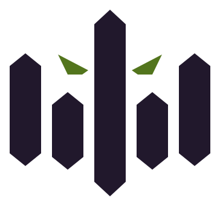

# WisprNo Fangs brand kit

Open brand-sheet.html to view and download all 12 versions. Every SVG has a transparent background; there is no square behind the mark.

## Choose a version
- icon: standalone waveform/eyes.
- horizontal: symbol with WisprNo beside it; navigation and headers.
- stacked: symbol above WisprNo; splash screens and title cards.
- dark: lilac/lime for dark surfaces.
- light: plum/olive for light surfaces.
- mono-dark: white for dark surfaces.
- mono-light: plum for light surfaces.

## UI usage
```html
<link rel="stylesheet" href="wisprno.css">


```

To recolor individual shapes, inline the SVG and add class="wisprno-inline" to its root. Add wisprno-inline--light or wisprno-inline--mono for variants. External img files cannot inherit CSS fill colors from the page. Group IDs are waveform, eyes and wordmark; rename IDs if combining multiple inline logos in the same document.

All lettering reads WisprNo, with a capital W and N. Wordmark letters are vector outlines based on DejaVu Sans regular/bold, so no font installation is required. Paths remain editable in Figma, Illustrator and SVG editors; text is no longer live type. Icon geometry is a clean vector adaptation of the selected Fangs concept: five faceted bars, tall centre, medium outer bars and shorter inner bars.

Recommended minimums: 32px icon width; 160px horizontal width. Keep about one eye-width of clear space around the mark. Do not stretch the viewBox. At very small sizes use the mono version. No JavaScript, raster images, external font downloads or dependencies are required.

PNG exports are included at 1024px with transparent backgrounds. Fangs-preview.png is a presentation sheet; use SVG files for scalable UI assets.
